<div align="center">




<a href="https://duttaanubhab777-code.github.io/My-Portfolio/">
  
</a>

<br/>

<a href="https://duttaanubhab777-code.github.io/My-Portfolio/"></a>
<a href="https://duttaanubhab777-code.github.io/My-Portfolio/contact.html"></a>
<a href="https://github.com/duttaanubhab777-code?tab=repositories"></a>

<br/>


</div>


## 🚀 About Me

<table>
<tr>
<td width="55%" valign="top">

- 💻 **Full-stack developer** — frontend (HTML, CSS, JS, React) and backend (Node.js, Express, Python/Flask)
- 🛠️ I learn **hands-on** — every project teaches me something new
- 🎓 I love making tools that help **students** learn and solve problems
- 🌱 Currently exploring: **new languages & deeper backend development**
- 📱 I code **entirely from my phone**

</td>
<td width="45%" valign="top">

```js
const anubhab = {
  role: "Full-Stack Developer",
  learning: "by shipping projects",
  setup: "📱 phone-only",
  stack: ["React", "Node", "MongoDB", "Flask"],
  openToCollab: true,
};
```

</td>
</tr>
</table>


## 🎬 Project Gallery

<div align="center">
  
</div>


## ⭐ Featured Projects

### 🧱 Full-Stack (built solo)

| Project | What it is | Stack |
|---|---|---|
| 📧 [**Email Sender**](https://github.com/duttaanubhab777-code/Email-Sender) · [Live](https://email-sender-wy5o.onrender.com) | A form-to-inbox API with login/register, background delivery, retries and a security-focused backend — powers my portfolio's contact form | `React` `Node.js` `Express` `MongoDB` `Flask` `PWA` |

### 🤝 Collaborations (frontend by me · backend by [Arnab Adhikari](https://github.com/arnabadhikari777))

| Project | What it is | Stack |
|---|---|---|
| 🧪 [**Friendly Flux**](https://github.com/duttaanubhab777-code/Friendly-Flux) · [Live](https://duttaanubhab777-code.github.io/Friendly-Flux/frontend/) | STEM problem solver for physics, chemistry and maths with handwriting OCR | `JavaScript` `Python` `Flask` |
| 🤖 [**Beyonder AI**](https://github.com/duttaanubhab777-code/Beyonder-Ai-2.0) · [Live](https://anubhabdutta.pythonanywhere.com) | Student-focused AI learning companion for concepts, problem solving and revision | `JavaScript` `Python` `Flask` `AI` |
| 📰 [**AA News**](https://github.com/arnabadhikari777/AA_News) · [Live](https://arnabadhikari125117y.pythonanywhere.com/) | Categorized news platform with a smooth mobile-friendly UI | `JavaScript` `Python` `Flask` |

### 🚀 More Projects

| Project | What it is | Stack |
|---|---|---|
| ⛅ [**Weather App**](https://github.com/duttaanubhab777-code/Live-Weather-App) · [Live](https://duttaanubhab777-code.github.io/Live-Weather-App/) | Live weather web app | `HTML` `CSS` `JavaScript` |
| 🧮 [**Calculator**](https://github.com/duttaanubhab777-code/Calculator) · [Live](https://duttaanubhab777-code.github.io/Calculator/) | Phone-style calculator | `HTML` `CSS` `JavaScript` |
| ⭕ [**Tic-Tac-Toe**](https://github.com/duttaanubhab777-code/Tic-Tac-Toe) · [Live](https://duttaanubhab777-code.github.io/Tic-Tac-Toe/) | Browser game with win/draw detection | `HTML` `CSS` `JavaScript` `PWA` |
| 🔳 [**QR Code Generator**](https://github.com/duttaanubhab777-code/QR-Code-Generator) · [Live](https://duttaanubhab777-code.github.io/QR-Code-Generator/) | Generate QR codes instantly | `HTML` `CSS` `JavaScript` |
| 📊 [**Result Analysis**](https://github.com/duttaanubhab777-code/Result-Analysis) · [Live](https://duttaanubhab777-code.github.io/Result-Analysis/) | Result calculator built for class 11–12 science students | `HTML` `CSS` `JavaScript` |
| 🌐 [**My Portfolio**](https://github.com/duttaanubhab777-code/My-Portfolio) · [Live](https://duttaanubhab777-code.github.io/My-Portfolio/) | My showcase site — dark cyberpunk UI with lots of animation | `HTML` `CSS` `JavaScript` |


## 🛠️ Tech Stack

<div align="center">


</div>


## 📈 GitHub Stats

<div align="center">


</div>

## 🐍 Contribution Snake

<div align="center">
  <picture>
    <source media="(prefers-color-scheme: dark)" srcset="https://raw.githubusercontent.com/duttaanubhab777-code/duttaanubhab777-code/output/github-snake-dark.svg" />
    <source media="(prefers-color-scheme: light)" srcset="https://raw.githubusercontent.com/duttaanubhab777-code/duttaanubhab777-code/output/github-snake.svg" />
    
  </picture>
</div>


## 🤝 Let's Connect

<div align="center">

<a href="https://duttaanubhab777-code.github.io/My-Portfolio/contact.html"></a>
<a href="https://github.com/duttaanubhab777-code?tab=repositories"></a>

<br/><br/>


</div>

